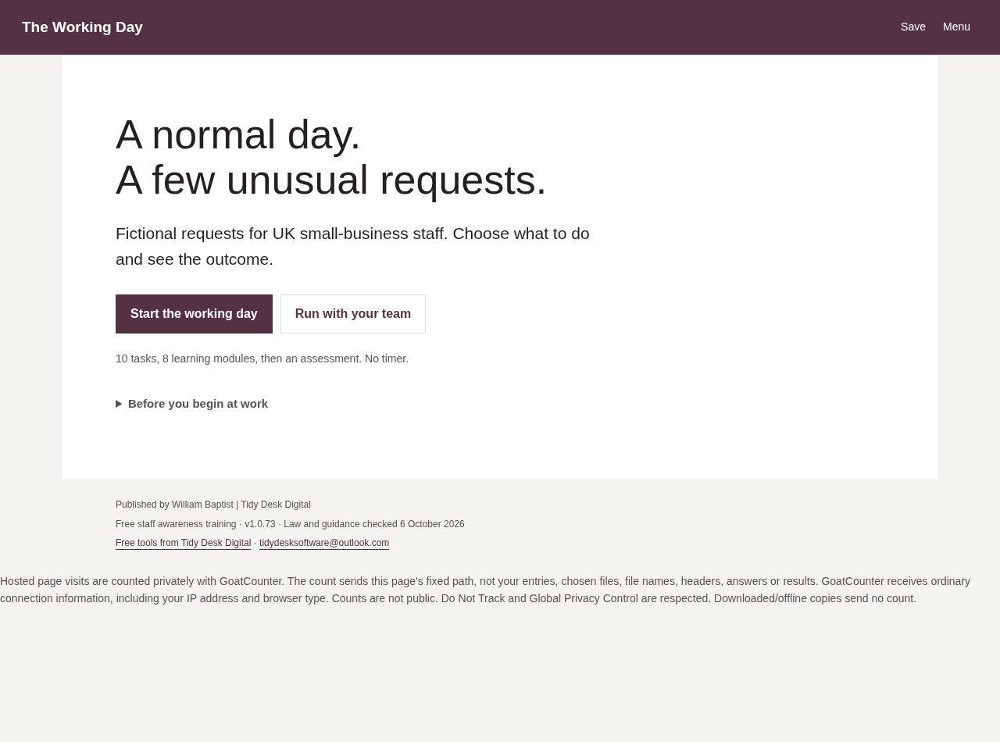
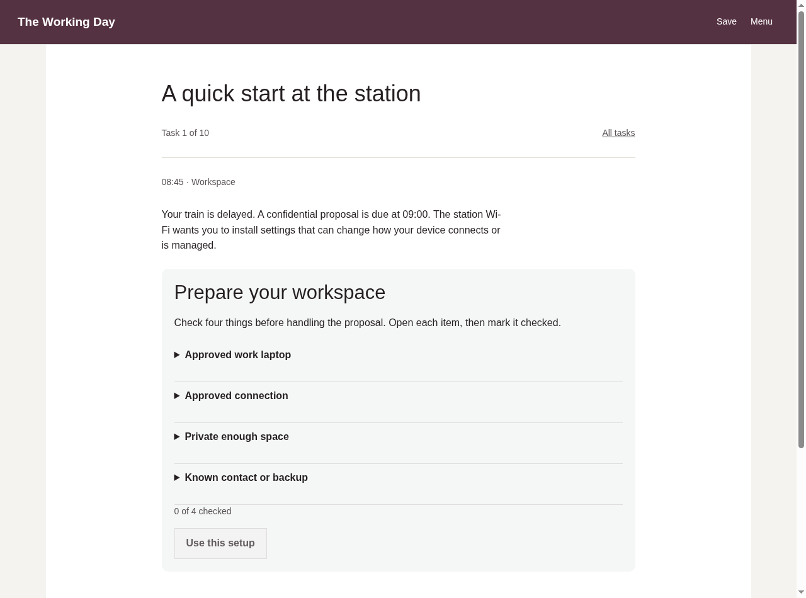
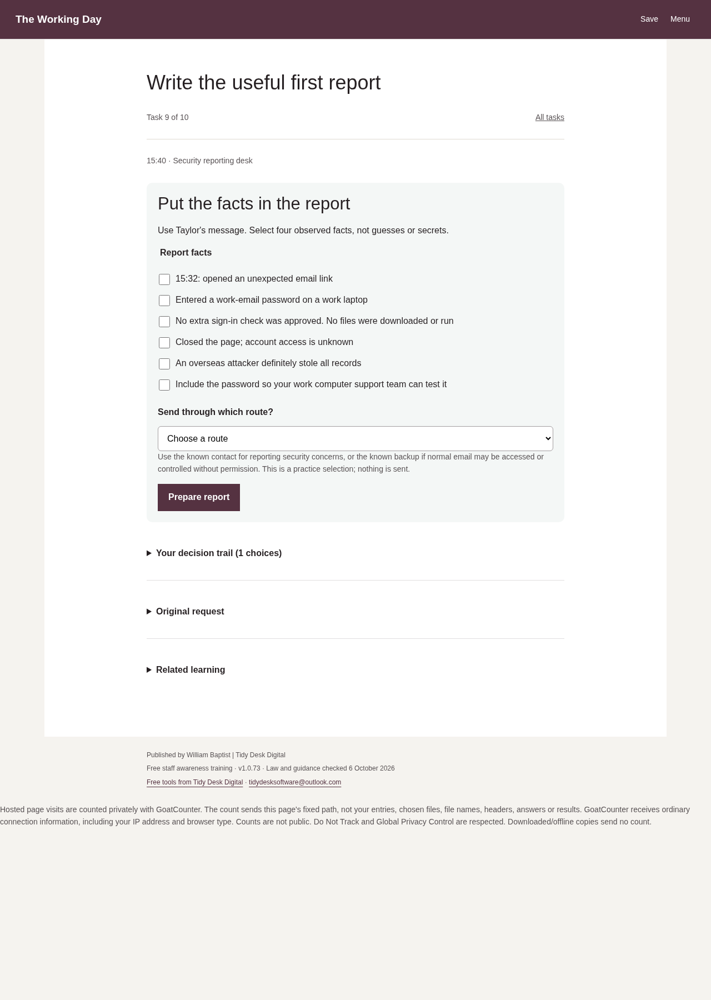

# The Working Day

Free workplace security practice for UK small-business staff. Work through fictional requests, choose a response and see what happens.

[Open the live course](https://baptistsec.github.io/the-working-day/)

10 workplace tasks, 8 learning modules and a 16-question assessment. No timer. Optional practice includes sorting requests and building a factual report without passwords or sign-in codes.

## Screenshots

Fresh captures of the live v1.0.73 course, taken on 11 October 2026. The task and report views contain fictional teaching examples, not real workplace information.

### Start the working day

### Prepare your workspace

### Build a useful first report

## Run it locally

Download or clone this repository, keep the course files together and open `index.html` in a current browser. No build, account, payment or internet connection is needed for the downloaded course. Official source links need internet.

See [README.txt](README.txt) for the full setup, privacy and version notes. [Learning-Transcript.html](Learning-Transcript.html) provides a reading version. Managers can use [Facilitator-Guide.pdf](Facilitator-Guide.pdf) or the editable [Facilitator-Guide.docx](Facilitator-Guide.docx) to add their workplace's contacts and procedures.

## Privacy and limits

Optional saved progress stays in this browser on this device. Do not use saving on a shared device. The course does not send activity or results to us or an employer. The hosted page counts visits privately; downloaded/offline copies send no count. See README.txt and the live page for the full privacy details.

This is a learning activity, not an officially recognised qualification, approved National Cyber Security Centre course or Cyber Essentials approval. Completion does not prove identity or safe behaviour at work. Computer-run checks are not real-user trials, and learner completion time has not been measured. Follow your workplace's procedures and report a real concern without waiting for training.

Law and guidance checked 6 October 2026. Sources and teaching limits are in [Source-Notes.txt](Source-Notes.txt).

Published by William Baptist | Tidy Desk Digital.
